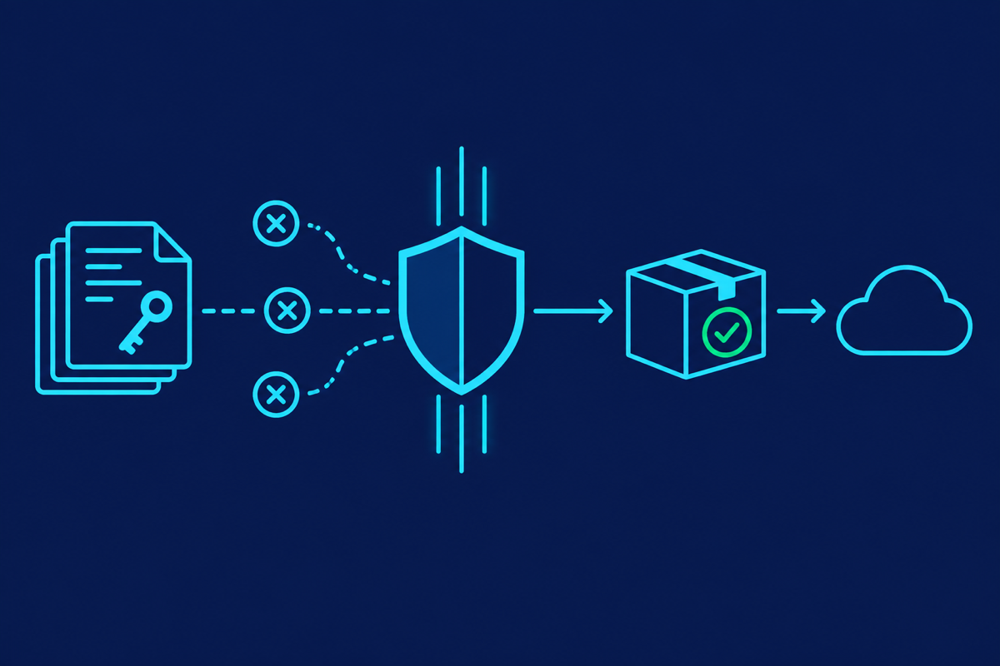

# Cyberine ReleaseGuard



Cyberine ReleaseGuard (`cyberine-releaseguard`) is a Claude Code plugin, and `shipsafe` (npm `@cyberinecore/shipsafe`) is its standalone CLI; together they stop npm packages from shipping their source by accident. Claude Code's own npm package leaked its full source twice this way (an inline source map in February 2025, a 60 MB `cli.js.map` with `sourcesContent` in March 2026): the bundler emitted maps by default and nothing checked the tarball that was published.

What it does not do: make JavaScript unreversable. Minified JS, and the JS embedded in a Bun single-file executable, stay readable with effort. shipsafe prevents accidental leaks and keeps the release process honest; logic that must stay secret belongs on a server.

## Parts

- **`shipsafe check <file.tgz>...`**: a zero-dependency Node CLI (Node 18+). It reads each real packed tarball and exits 1 on any finding, 2 on a usage or config error, 0 when every tarball is clean, printing each tarball's sha256. With `--json` it prints one report object for a single file and an array for several; `--format sarif` prints one SARIF 2.1.0 run for GitHub code scanning (allowed findings carry a suppression with their reason), and `--format markdown` prints a PR-ready summary with the sha256, findings, exceptions and a collapsible file inventory. `diff` takes `--format markdown` too.
- **`shipsafe diff <new.tgz> [<old.tgz> | --against <name@version|dist-tag>]`**: what changed since the previous release (default: the `latest` tarball on the registry, downloaded from the packument's `dist.tarball`). It lists added, removed and grown files and labels risk-raising changes: `new-lifecycle-script`, `new-dependency`, `new-bin`, `new-export`, `new-exception` (a new `shipsafe.allow` entry) and `size-jump` (a file that grew by `growthFactor`, default 2, and more than 1 KiB). Informational: it exits 0 unless it cannot run. The first release prints `no baseline`.
- **`shipsafe audit <name> [--versions N]`**: an incident tool, not a release stage. It downloads the last N published versions (default 5), checks each against its `dist.integrity`, and gates it with the same rules; exit 1 when any version leaks.
- **Other archives**: `check` also reads `.vsix` files (rooted at `extension/`, with every rule except `lifecycle-script` and `publish-intent`, since VS Code runs no install scripts) and browser-extension `.zip` files (`manifest.json` at the root; the leak rules plus TypeScript, `src/` and test paths, and a warning for broad host permissions such as `<all_urls>`). The zip reader handles stored and deflate entries, rejects zip64, encrypted and multi-disk archives, and treats symlinks as `archive-integrity` findings. It also reads Electron `.asar` archives, directly or nested inside a `.zip` (for example `App.app/Contents/Resources/app.asar`), with the leak rules plus TypeScript and test paths; ordinary app JavaScript is expected there and is not a finding, and files kept in `app.asar.unpacked` are listed as warnings. `vsce publish --packagePath <file>.vsix` and `ovsx publish <file>.vsix` re-run the gate on that file; without a named `.vsix` they trigger an ask, and browser-store uploads are not intercepted at all: gate the zip before you upload it.
- **`shipsafe check-dir <dir>...`**: the same engine for a static-site build output (`dist/`, `build/`): source maps, `sourcesContent`, inline or remote maps, credential files and strings, bucket URLs and build metadata. `node_modules/` is skipped and symlinks are findings. Config comes from the `shipsafe` key of the nearest `package.json` at or above the directory, so no extra file deploys to the CDN.
- **PreToolUse hook**: fires for Bash commands that look like a publish, upload or deploy. It never blocks anything: when something looks wrong it answers `ask`, so Claude Code pauses and shows you the reason and the suggested fix, and you decide whether the command runs. Measured 2026-09-27 with headless sessions: the ask still stops the command under `bypassPermissions` and when `--allowedTools` allows it; a non-interactive session has no one to answer, so the command does not run there. It asks about a publish that does not name a `.tgz`, re-runs the gate on the named tarball and asks on any finding, and always asks about `yarn npm publish`, which cannot publish a prebuilt tarball. It also asks about a publish whose flags contradict the packed metadata: a scoped package with neither `--access` nor `publishConfig.access`, a `--registry` that differs from `publishConfig.registry`, and a prerelease version headed for the `latest` dist-tag (publish it with `--tag next`). Dry runs pass. A clean command gets no answer from the hook at all, so the normal permission flow applies to it unchanged. It also looks inside `npm run <script>` and `make <target>` one level deep, gates the source directory of bucket and server uploads (`aws s3 sync`, `gsutil`, `gcloud storage`, `az`, `azcopy`, `rclone`, `rsync`, `scp`) like `check-dir`, and asks before deploys that build remotely from source; the table under Limits lists every command family.
- **Skills** (slash commands): `/cyberine-releaseguard:release` runs the whole release, auto-triggered when you ask Claude to publish; `/cyberine-releaseguard:init` sets a repo up (files allowlist, maps off, prepack build, CI gate); `/cyberine-releaseguard:check` gates a package without publishing; `/cyberine-releaseguard:verify` proves the registry holds exactly the checked tarball; `/cyberine-releaseguard:incident` handles a leak already on npm; `/cyberine-releaseguard:help` routes to the right one. The release skill carries the build, pack, gate and hand-over procedure for libraries (bundle, minify, no maps, bundled `.d.ts`, `files` allowlist) and executables (`bun build --compile --minify` per platform, shipped as per-platform packages behind a launcher). The OTP step stays with the human.

## Rules

| rule | fails on |
|---|---|
| `source-map` | any `*.map` file |
| `sources-content` | any file containing a `sourcesContent` key |
| `inline-source-map` | `sourceMappingURL=data:...` |
| `remote-source-map` | `sourceMappingURL=http(s)://...` |
| `typescript-source` | `.ts`, `.tsx`, `.mts`, `.cts` other than declaration files |
| `source-dir` | any path inside a `src/` directory |
| `test-path` | `test/`, `tests/`, `__tests__/`, `__mocks__/`, `__fixtures__/`, `*.test.*`, `*.spec.*` |
| `sensitive-file` | `.env*` (except `.env.example`), `.dev.vars*`, `.npmrc`, `.git-credentials`, `.netrc`, `.pypirc`, `.aws/credentials`, `.aws/config`, `*.tfstate`, `*.tfstate.backup`, `*.tfvars` (not `*.tfvars.example`), `kubeconfig`, `.kube/config`, `.docker/config.json`, anything under `.ssh/`, `.mcp.json`, `.claude/settings.local.json`, `*.pem`, `*.key`, `*.p12`, `*.pfx`, `*.jks`, `*.keystore`, `id_rsa*`, `.git/` |
| `data-file` | `*.sqlite`, `*.sqlite3`, `*.db`, `*.dump`, and a `*.sql` file that holds rows (`INSERT INTO`, `COPY ... FROM stdin`, a `pg_dump`/`mysqldump` header); schema-only `.sql` migrations pass. A fixture that must ship is allowed with a reason |
| `build-artifact` | `*.tsbuildinfo`, `coverage/`, `.nyc_output/`, and esbuild metafiles (`meta.json` / `metafile.json` with `inputs` and `outputs`), which list every source path |
| `file-size` | a file larger than `maxFileBytes` (default 5 MiB) |
| `bucket-url` | S3, R2, GCS, Azure Blob, DigitalOcean Spaces, Backblaze B2 or Wasabi hostnames and `s3://` / `gs://` URLs |
| `lifecycle-script` | a `preinstall`, `install` or `postinstall` script in the packed `package.json`, or a shipped `binding.gyp` (npm then runs `node-gyp rebuild` on install); allow one with `"path": "package.json#<script>"` |
| `secret-token` | AWS `AKIA`/`ASIA` keys, GitHub `ghp_`/`gho_`/`ghu_`/`ghs_`/`ghr_`/`github_pat_` tokens, npm `npm_` tokens, Stripe `sk_live_`/`rk_live_` keys, Slack `xox[abpr]-` tokens, GitLab `glpat-` tokens (20 or more characters, routable tokens included), SendGrid `SG.<22>.<43>` keys, Azure storage `AccountKey=` values (88 base64 characters), PEM private key blocks, Anthropic and OpenAI API keys, connection URLs with an embedded password (`postgres`, `mysql`, `mongodb`, `redis`, `amqp`, `http(s)`, `ftp`) and literal `Authorization: Basic` headers inside any shipped file. URL and Basic credentials are decoded and skipped when the password is a placeholder (`password`, `changeme`, `${VAR}`, `<token>`, the username repeated, words like `pass` or `secret`) or the host is reserved for examples (`example.com`, `.test`, `.invalid`). Generic `Bearer` tokens, `x-api-key` values and Google `AIza` keys are deliberately not matched: they have no shape that separates a secret from a documented example, and Firebase web keys are public by design. The report shows only the kind and length, plus a prefix for the fixed-prefix tokens |
| `publish-intent` | `"private": true`, or a prerelease version with `publishConfig.tag` set to `latest` (a prerelease with no tag at all is a warning, since `--tag` may come on the command line) |
| `entry-point` | a `main`, `module`, `types`/`typings`, `browser`, `bin` or `exports` target (conditions, arrays and `*` subpath patterns included) that is not in the tarball; export shape itself is left to publint and attw |
| `archive-integrity` | symlink, hardlink, device or FIFO entries and duplicate paths, which the scan cannot vouch for |

A tarball that is truncated, malformed, has an entry escaping the package root (`..` or an absolute path), or unpacks to more than 1 GiB is a hard error (exit 2), not a finding.

## Configuration

Configuration lives in the packed `package.json`, so the CLI in CI and the hook in Claude Code judge the same tarball the same way:

```json
"shipsafe": {
  "maxFileBytes": 262144000,
  "growthFactor": 3,
  "allow": [
    { "rule": "bucket-url", "path": "dist/*.js", "reason": "documented public download bucket" }
  ]
}
```

`path` takes `*`, `**` and `?`. Every exception needs a reason, and unused exceptions are reported as warnings. Two hook behaviours are opt-in and live in a `.claude/shipsafe.json` at or above the working directory rather than in the packed `package.json`, because they describe a repository, not an artifact: `{ "askOnDockerPush": true }` asks before image pushes, `{ "askOnTagPush": true }` asks before tag pushes that trigger a release workflow. The nearest file wins. Rules about `package.json` itself use `package.json#<field>` as the path, for example `package.json#postinstall`. Unknown keys (a typo such as `maxFilesBytes`) are warnings, and so is any nested archive (`.zip`, `.tgz`, `.jar`, ...), because the gate does not look inside it.

## Install the plugin

```sh
claude plugin marketplace add cyberinecore/cc-release-guard
claude plugin install cyberine-releaseguard@cyberine-releaseguard
```

Official sources are only `github.com/cyberinecore/cc-release-guard` and the npm package `@cyberinecore/shipsafe`; anything under another owner is not this project.

The plugin needs Claude Code 2.1.139 or later, the first version with exec-form hooks (`args`); on an older Claude Code the hook does not run. The hook needs Node.js 18 or later on `PATH`. If `node` is missing, the hook errors and Claude Code carries on without it.

## Use in CI

Add the CLI to the project's `devDependencies` at an exact version (`npm install --save-dev --save-exact @cyberinecore/shipsafe`), so `npm ci` installs the reviewed version from the lockfile, then gate the packed file:

```sh
npm ci
npm pack --pack-destination out
node_modules/.bin/shipsafe check out/*.tgz
for f in out/*.tgz; do npm publish "$f" --access public; done
for f in out/*.tgz; do node_modules/.bin/shipsafe verify "$f"; done
```

`shipsafe verify <file.tgz> [--registry <url>]` reads name@version from the tarball, fetches the registry's `dist.integrity` (from `publishConfig.registry`, else the npm registry) and exits 0 only when it equals the local file's sha512; 1 when the version is missing or holds a different file; 2 when the registry is unreachable. A publish from CI never passes through the hook, so this is how CI proves the file it checked is the file it published. For a wheel or sdist it compares the file's sha256 with the matching file on PyPI (`--registry` takes the base URL of another package index); for a `.crate` it compares with the `cksum` in the crates.io sparse index, which only matches when the checked file is the one cargo uploaded.

For a workspace, pack every package into `out/` (`npm pack --workspaces --pack-destination out`); `check` gates them all in one run and fails if any one fails.

Or use the composite action from this repository, which runs the CLI from its own checkout (no npm install) and writes a markdown report to the job summary:

```yaml
- uses: cyberinecore/cc-release-guard@v0
  id: shipsafe
  with:
    working-directory: .
```

Then publish each path the action lists in its `tarballs` output.

Inputs: `tarballs` (a glob such as `out/*.tgz`; empty packs `working-directory` with `npm pack`), `working-directory`, `summary` (`true`/`false`). Output `tarballs` lists the absolute paths that passed, so the publish step uploads exactly those files. `@v0` follows the latest 0.x release; pin `@v0.1.0`, or a commit SHA, to freeze the exact gate. Each tag runs the same CLI as the npm version of the same number.

To see the result in review, append `--format markdown` output to the job summary and upload `--format sarif` output with `github/codeql-action/upload-sarif` (needs `security-events: write`); this repo's `.github/workflows/ci.yml` does both.

Publish the file the gate checked, never the working tree: `npm pack --dry-run` does not run `prepublishOnly`, so it can list a different file set from the one that ships.

## Network and data

- The hook and `check`/`check-dir` make no network calls: they read local files only and send nothing anywhere. There is no telemetry.
- `verify`, `diff` (against a registry version) and `audit` contact only the registry the command targets: the npm registry, or `publishConfig.registry`/`--registry`, PyPI or the crates.io index. They send the package name and version and download public metadata and tarballs.
- The hook and the CLI never start another program and never install anything. Package runner names appear in the source only so the hook can recognize a publish wrapped in one, and export commands appear only in hints printed for you to run.
- shipsafe never reads, stores or sends registry tokens or OTPs; the human types the OTP into the publish command.
- The hook writes one empty marker file per tool call in the OS temp directory (`shipsafe-hook-<tool_use_id>`) so overlapping hook filters answer only once; markers older than a day are removed.
- The full privacy policy is in [PRIVACY.md](PRIVACY.md); report security issues as described in [SECURITY.md](SECURITY.md). Release notes are in [CHANGELOG.md](CHANGELOG.md).

## Limits

What the hook intercepts, and what it does with each command family:

| Command family | What the hook checks | On a problem |
|---|---|---|
| `npm|pnpm|yarn|bun publish [file.tgz]`, `npm stage publish` | re-runs the gate on the named tarball; flags contradicting the packed metadata | ask |
| `npm run <script>`, `make <target>` | the publish or deploy inside the script or recipe, one nested level | ask, prefixed `via` |
| `lerna`/`changeset publish`, `semantic-release`, `release-it`, `np` | nothing to check: they pack and publish in one step | ask with a pack-gate-publish recipe |
| `twine`, `uv`, `hatch`, `maturin upload`, `poetry`, `pdm`, `flit`, `cargo publish` | the named or `dist/` wheels and sdists; `cargo` shows the `target/package` crate | ask |
| `dotnet nuget push`, `nuget push`, `gem push`, `helm push`, `mvn deploy:deploy-file` | the named `.nupkg`, `.gem`, chart `.tgz` or `.jar` | ask |
| `mvn deploy`, `gradle publish*`, `goreleaser release` | nothing to check: no artifact is named | ask with a build-check-upload recipe |
| `jsr publish`, `deno publish` | the working directory, leak rules only | ask |
| `vsce publish`, `ovsx publish` | the `.vsix` given with `--packagePath`; without one, nothing | ask |
| `wrangler pages deploy`, `wrangler deploy`, `netlify deploy`, `firebase deploy`, `vercel --prebuilt`, `eas update --skip-bundler` | the output directory, like `check-dir` | ask |
| `aws s3 sync|cp`, `gsutil`, `gcloud storage`, `az storage blob upload-batch|sync`, `azcopy`, `rclone`, `rsync`, `scp -r` to a remote | the local source directory, like `check-dir` | ask |
| `vercel`, `fly deploy`, `railway up`, `gcloud run|app|functions deploy`, `sam deploy`, `cdk deploy`, `serverless deploy` | nothing to check: the artifact is built during the deploy | ask once, with a `check-dir` hint |
| `gh release create|upload` | attached archives | ask |
| `docker|podman push`, `compose push`, `build --push` | nothing to check; opt-in with `askOnDockerPush` | ask with a `docker save` recipe |
| `git push --tags|--follow-tags|<tag>` | whether a workflow runs on tag pushes; opt-in with `askOnTagPush` | ask |

- The hook fires in every permission mode, `bypassPermissions` included (checked 2026-09-27 with a headless session), and its answer is always `ask`, never a hard block. It does not fire for commands the user types with the `!` prefix (checked 2026-09-27 in an interactive session: `! npm publish` ran with no ask), so a publish the user runs by hand should run the gate in the same line: `shipsafe check x.tgz && npm publish x.tgz`, which is the line `/cyberine-releaseguard:release` hands over.
- The hook sees commands Claude runs. A terminal outside Claude Code and a CI job are not intercepted; run the gate in CI for those.
- Script wrappers: `npm|pnpm|yarn|bun run <script>` (and `run-script`) reads the script from the nearest `package.json`, including `pre<script>`/`post<script>` and, for a working-tree publish, the `prepublishOnly`/`prepack`/`postpack`/`publish`/`postpublish` chain, and judges the publish or deploy it finds there; one nested `npm run x` level is followed. `make <target>` reads the recipe from the Makefile (`-C`, `-f`, `$(VAR)` substitution, one `$(MAKE)` level); a Makefile that cannot be parsed stays silent. The ask is prefixed `via npm run <script>` or `via make <target>`. To keep plain `npm run build` from ever spawning the hook, the `if` filters only match scripts and targets whose name contains `release`, `publish`, `deploy` or `ship` (plus every `run-script`); a script named otherwise is seen by the engine but not spawned for.
- Command matching is best-effort by design: it targets accidents, not a user deliberately bypassing it.
- Release orchestrators that pack and publish on their own (`lerna publish`, `changeset publish`, `semantic-release`, `release-it`, `np`) trigger an ask outside their dry-run modes, with a pack, gate, publish-each-tarball recipe. `npm stage publish <file>.tgz` is gated like `npm publish`.
- The hook looks through shell wrappers (`sh`, `bash` or `zsh` given `-c`), `eval`, corepack, and the package runners of npm, pnpm, Yarn and Bun, including their `exec` and `dlx` subcommands. A publish fed its tarball by `xargs` or `find -exec` always triggers an ask, because the file that ships cannot be known before it runs.
- Static deploys: the hook gates `wrangler pages deploy <dir>` (or `pages_build_output_dir` from `wrangler.toml`/`wrangler.json`), `vercel [deploy] --prebuilt` (`.vercel/output/static`), `netlify deploy --dir <dir>` (or `publish` from `netlify.toml`) and `firebase deploy` including hosting (`hosting.public` from `firebase.json`). A deploy whose directory cannot be determined triggers an ask with a hint. `vercel`, `vercel --prod` and `vercel deploy` without `--prebuilt` build remotely from source, so they trigger an ask that says shipsafe cannot see the artifact and points at `vercel build`, `shipsafe check-dir .vercel/output/static`, `vercel deploy --prebuilt`; `vercel dev`, `build`, `env` and the other non-deploy subcommands pass. `wrangler deploy` and `wrangler versions upload` gate a Worker's static assets directory: `--assets <dir>` (or legacy `--site`), else `assets.directory` (or `site.bucket`) from `--config`, the Cloudflare Vite plugin's `.wrangler/deploy/config.json` redirect, `wrangler.jsonc`, `wrangler.json` or `wrangler.toml`, with `--env` overrides; a Worker without assets passes. The Worker script itself is bundled by wrangler during the upload and is not seen.
- Package registries beyond npm: `dotnet nuget push <file>`, `nuget push <file>`, `gem push <file>` and `mvn deploy:deploy-file -Dfile=<file>` are gated on the named `.nupkg`, `.gem` or `.jar` with the leak rules only (source and tests are normal in those ecosystems; a `src/` directory in a non-symbols `.nupkg` is a warning). `mvn deploy`, `gradle publish` and `./gradlew publish*` (not `publishToMavenLocal`) and `goreleaser release` (not `--snapshot` or `--skip=publish`) name no artifact shipsafe can check, so they trigger an ask with a build, check, then upload recipe.
- Bucket and server uploads: `aws s3 sync|cp <dir> s3://...` (`cp` with `--recursive` or a directory source), `gsutil [-m] rsync|cp -r <dir> gs://...`, `gcloud storage rsync|cp -r <dir> gs://...`, `az storage blob upload-batch|sync -s <dir>`, `azcopy copy|sync <dir> https://...`, `rclone sync|copy <dir> <remote>:...`, `rsync <dir> host:path` and `scp -r <dir> host:path` gate the local source directory like `check-dir` (leak rules, `sensitive-file`, `data-file`). Downloads, bucket-to-bucket copies, single-file uploads and local destinations pass; a source that cannot be resolved (`$BUILD_DIR`) or does not exist triggers an ask with a hint. `--exclude` patterns are not applied, so a sync that excludes `.git/*` may still be asked about.
- Remote builders: `fly deploy` (and `fly launch`), `railway up`, `gcloud run deploy --source`, `gcloud app deploy`, `gcloud functions deploy`, `sam deploy`, `cdk deploy` and `serverless|sls deploy` build or package during the upload, so they trigger one ask saying shipsafe cannot see the artifact, with a `check-dir` hint when a local build directory (`dist`, `build`, `out`, `.output/public`, `.vercel/output/static`) exists.
- JSR: `jsr publish` and `deno publish` upload the working directory, where TypeScript source is the point, so only the leak rules run on it; `.git/`, `node_modules/`, paths matched by the root `.gitignore` and by `publish.exclude` in `jsr.json`/`deno.json(c)` are skipped, and `publish.include` restricts the set. `--dry-run` passes.
- VS Code and Open VSX: `vsce publish` and `ovsx publish` (also through a package runner) trigger an ask unless they name a `.vsix` with `--packagePath`/`-i` (or, for ovsx, as a positional); the named file is gated like `shipsafe check`. `vsce package` passes.
- Release tags (opt-in): with `{ "askOnTagPush": true }` in `.claude/shipsafe.json`, `git push --tags` and `git push --follow-tags` trigger an ask, and `git push <remote> <ref>` does when `<ref>` is a tag (`refs/tags/...`, `tag <name>`, a tag in `.git/refs/tags` or `packed-refs`, or a name matching a workflow's tag filter) and a file in `.github/workflows/` runs `on: push: tags` for it. Branch pushes, `--dry-run` and deletions pass. Off by default, so plain `git push` never asks.
- Python and Rust: `check` reads wheels (`.whl`), sdists and `.crate` files. Source and tests are normal there, so they get the leak rules plus `file-size` and `vcs-dir` (`.venv/`, `.tox/`, caches, `node_modules/`, a crate's `target/`); wheels also get `wheel-record` (RECORD must match the files and their hashes), `entry-point` (console scripts must resolve to a shipped module), `native-debug-info` (`.pdb`, `.dSYM`), `test-path` for a top-level `tests/` package, and warnings for `.pyc` files, test modules inside a package, and unstripped native extensions. Config: sdists read `[tool.shipsafe]` from their packed `pyproject.toml`, crates read `[package.metadata.shipsafe]` from their packed `Cargo.toml`, and wheels, which carry no `pyproject.toml`, read the nearest one on disk at or above the wheel whose `[project].name` matches the wheel; if none matches, strict defaults apply and the report says so.
- Python and Rust uploads: the hook checks the files `twine upload`, `uv publish`, `hatch publish` and `maturin upload` name (also through `python -m` and the pipx and uv tool runners), and the `dist/` directory that `uv publish` with no files, `poetry publish` and `pdm publish --no-build` upload. Commands that build during the upload (`poetry publish --build`, `pdm publish` without `--no-build`, `flit publish`, `maturin publish`) and `hatch publish` with no files trigger an ask with a build, check, upload recipe. `cargo publish` always triggers an ask outside `--dry-run`: it re-packages the tree instead of uploading a checked file, so the ask shows whether `target/package/<name>-<version>.crate` exists, its sha256 and its gate result, and suggests `--locked`.
- Container images: `check image.tar` reads a `docker save` or OCI layout archive and scans every layer, not just the final filesystem, so a `.env` removed by a later `RUN rm` is still reported with the layer that holds it; the image config `Env` and build history are scanned for tokens. Images get only `sensitive-file` and `secret-token`, and system and vendor paths (`/etc/ssl`, `/usr/lib`, `node_modules`, `site-packages`) are skipped, so CA certificates and library fixtures are not findings. zstd layers are reported as not scanned. `docker push` names an image, not a file, so the hook cannot check it: by default it stays silent. Opt in with `{ "askOnDockerPush": true }` in a `.claude/shipsafe.json` at or above the working directory (the nearest file wins, so a repo can turn off a home-wide opt-in) and the hook then asks before `docker push`, `docker image push`, `podman push`, `docker compose push` and `docker build`/`buildx build|bake` with `--push` or a registry output, with the recipe `docker save -o /tmp/image.tar <image>`, `shipsafe check /tmp/image.tar`, then push.
- Helm charts: `check` reads a `helm package` `.tgz` (a root `Chart.yaml` after the chart directory) with the leak rules, and `values*.yaml` keys that look like credentials (`password`, `token`, `secret`, `apiKey`, ...) holding a literal value are `secret-token` findings; empty values, templates, numbers and references (`existingSecret`, `secretName`, `passwordKey`) are not. Subcharts in `charts/*.tgz` are opened and scanned. `templates/tests/` is Helm's own convention and is not a `test-path` finding. The hook gates `helm push <chart>.tgz oci://...` and `helm cm-push <chart>.tgz`, and asks when either names a chart directory instead of a packaged file. Charts carry no config, so strict defaults apply.
- Expo OTA updates: `eas update` (also when started through a package runner) triggers an ask unless it publishes a prebuilt export with `--skip-bundler`; that export directory (`--input-dir`, default `dist`) is gated like `check-dir`. A bundle built during the upload is never seen, which is how source maps reach every installed app.
- GitHub releases: `gh release create|upload` triggers an ask when an attached `.tgz`/`.tar.gz` fails the gate (a tarball without a root `package.json` gets the leak rules only), and when an attached archive shipsafe cannot read yet (`.jar`, `.7z`, ...); `.zip` and `.vsix` assets are scanned. Other assets such as binaries and checksums pass unscanned.

## Related tools

These check different things or a different file set; run them alongside shipsafe rather than instead of it.

- publint and @arethetypeswrong/cli check that a package is well formed: `exports` shapes, module formats, type resolution. shipsafe only checks that entry points exist, and otherwise asks a different question: whether the tarball carries things that should never ship.
- secretlint has a much larger secret rule set and scans the files you point it at. shipsafe's `secret-token` rule covers a short list of high-confidence token formats, but it reads the packed tarball, so it sees exactly what reaches the registry and nothing that stays behind.
- gitleaks and trufflehog scan git history and repositories. A secret in history never ships in a tarball that excludes it, and a secret generated at build time ships without ever touching git; each tool answers for its own file set.

What shipsafe adds is the tarball-native view (maps, `sourcesContent`, source and test paths, install scripts, archive integrity on the exact file that is published) and the Claude Code hook that re-checks that file at publish time.

## License

MIT
